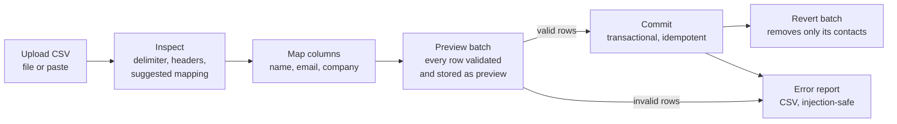

# ImportKit

ImportKit is an embeddable CSV onboarding flow for SaaS products. People upload a spreadsheet of contacts, map its columns to contact fields, review row-level validation, commit only the clean rows, download a report of the rows that need fixing, and undo a whole batch if something went wrong.

The backend is a typed Python service (FastAPI, SQLAlchemy 2.0, Alembic). It serves the bundled web UI from `public/` and exposes a documented JSON API that other frontends can embed.

## Import flow



1. **Inspect** (`POST /api/imports/inspect`): the file is parsed to detect the encoding (UTF-8 with or without BOM, or a Windows-1252 Excel export), the delimiter (`,` `;` tab `|`), and the headers. A column mapping is suggested from common synonyms (`Full Name`, `E-mail`, `Organization`, `Nome`, `Empresa`…). Nothing is stored at this step.
2. **Preview** (`POST /api/imports/preview`): every row is normalised and validated, then the batch is stored with status `preview`. Contacts are not touched yet.
3. **Commit** (`POST /api/imports/{id}/commit`): valid rows become contacts in one transaction. The batch id is the idempotency key, so repeating the call (a retry or a double click) returns the first result with `replayed: true` and creates nothing new. If another batch took an email after the preview was made, that row is marked `email_conflict` and the rest of the batch still goes through.
4. **Error report** (`GET /api/imports/{id}/errors.csv`): the invalid rows and their messages.
5. **Revert** (`POST /api/imports/{id}/revert`): deletes exactly the contacts created by that batch, atomically. Repeating the call is also safe.

## Validation rules

| Field / scope | Rule | Error code | Message |
|---|---|---|---|
| Row | Same number of columns as the header | `column_count_mismatch` | This row has a different number of columns than the header. |
| `name` | At least 2 characters after trimming | `name_too_short` | Enter a name with at least 2 characters. |
| `name` | At most 100 characters | `name_too_long` | Name is longer than 100 characters. |
| `email` | Valid address syntax (`email-validator`, no DNS lookup) | `email_invalid` | Enter a valid email address. |
| `email` | At most 180 characters | `email_too_long` | Email is longer than 180 characters. |
| `email` | Not already a contact in the workspace (case-insensitive) | `email_exists` | This email already exists in the workspace. |
| `email` | First occurrence in the file wins (case-insensitive) | `email_duplicate_in_file` | This email is duplicated in the uploaded file. |
| `email` | Still unique at commit time | `email_conflict` | This email was imported by another request. |
| `company` | Optional, at most 100 characters | `company_too_long` | Company is longer than 100 characters. |

Before validation, values are NFC-normalised, control and zero-width characters are removed, runs of whitespace are collapsed, and emails are lower-cased. Each error is structured as `{row, field, column, code, message}`. `row` is the spreadsheet row number (the header is row 1, and blank lines count, so it matches what Excel shows).

The whole upload is rejected, with a JSON `{error, code}` body, when the file is empty or malformed (`malformed_csv` for an unclosed quote), when it has no data rows, when two headers normalise to the same name, when the name or email column is missing, or when it goes over the size or row limit (`413`).

Addresses on the reserved `.test` TLD are rejected unless `IMPORTKIT_ALLOW_TEST_EMAIL_DOMAINS=true`.

## Error report security

The report is CSV data from third parties, and people will open it in Excel, LibreOffice or Google Sheets. Any cell that begins with `=`, `+`, `-`, `@`, a tab or a carriage return gets a leading `'`, so the spreadsheet shows it as text and never runs it as a formula (OWASP "CSV injection"). Every cell is also quoted. The file is UTF-8 with a BOM and CRLF line endings, so Excel opens it correctly, and it is sent as an attachment with a fixed, server-generated file name.

## Security

- **XSS:** the UI builds every piece of CSV-derived content with `textContent` and DOM nodes. It never assembles HTML strings from data.
- **CSP:** `default-src 'self'; script-src 'self'; style-src 'self'; object-src 'none'; base-uri 'none'; form-action 'self'; frame-ancestors …`. The policy has no `unsafe-inline`. Fonts are self-hosted, and the theme bootstrap is an external script. Only `/docs` and `/redoc` get a separate, looser policy for Swagger UI and ReDoc. Turn them off with `IMPORTKIT_ENABLE_DOCS=false`.
- **Other headers:** `X-Content-Type-Options: nosniff`, `Referrer-Policy: no-referrer`, `Permissions-Policy`, `Cross-Origin-Opener-Policy` and `Cross-Origin-Resource-Policy` on every response. API responses also get `Cache-Control: no-store`. HSTS is sent when `IMPORTKIT_ENVIRONMENT=production`.
- **Embedding:** `IMPORTKIT_FRAME_ANCESTORS` sets which sites may frame the UI. CORS is off by default. `IMPORTKIT_CORS_ORIGINS` takes explicit origins only; `*` is refused at startup.
- **Abuse limits:** request bodies are capped at the ASGI level, whether or not they declare a `Content-Length`. Uploads are capped by size (800 KB) and row count (10,000) by default. Writes (`POST`) are rate-limited per client with a token bucket, and limited requests get `429` with `Retry-After`.
- **Errors:** every error is JSON `{error, code, requestId?}`, including 404, 405, 413, 429 and unexpected 500s. A 500 never includes the internal exception.
- **Tracing:** each response carries an `X-Request-ID`, either a valid incoming one or a newly generated one. The same id appears in the structured JSON logs.

## API

FastAPI publishes interactive OpenAPI docs at **`/docs`** (Swagger UI), **`/redoc`**, and the raw schema at `/openapi.json`.

| Method & path | Purpose |
|---|---|
| `GET /api/health` | Liveness and database check (`503` if the database is unreachable) |
| `GET /api/dashboard` | Workspace metrics and the 6 latest imports |
| `GET /api/contacts?limit=&offset=` | Imported contacts, newest first (default 100, max 500) |
| `POST /api/imports/inspect` | Detect delimiter and headers and suggest a mapping (stateless) |
| `POST /api/imports/preview` | Validate and store a preview batch (`201`) |
| `GET /api/imports/{id}` | Batch detail with per-row results |
| `POST /api/imports/{id}/commit` | Commit valid rows (idempotent) |
| `POST /api/imports/{id}/revert` | Remove the batch's contacts (idempotent) |
| `GET /api/imports/{id}/errors.csv` | Download invalid rows |

`inspect` and `preview` accept the original JSON body `{"filename", "csv", "mapping": {"name", "email", "company"}}`, or `multipart/form-data` with `file` plus optional `filename`, `nameColumn`, `emailColumn` and `companyColumn`. Multipart lets the server detect the file's encoding.

```bash
curl -F file=@contacts.csv -F nameColumn="Full Name" -F emailColumn=E-mail \
  http://localhost:3205/api/imports/preview
```

## Running locally

You need Python 3.12 or newer and [uv](https://docs.astral.sh/uv/).

```bash
make install   # uv sync --frozen
make run       # alembic upgrade head + uvicorn --reload on http://localhost:3205
make check     # ruff, mypy --strict, pytest with coverage
```

Without `make`:

```bash
uv sync --frozen
uv run alembic upgrade head
uv run uvicorn --factory importkit.app:create_app --port 3205
```

With Docker:

```bash
docker compose up --build    # http://localhost:3205, data in the "importkit-data" volume
```

The UI starts empty. **Try sample data** loads a fictional preview, and **New import** opens the upload and mapping dialog.

## Configuration

All variables are optional; see [`.env.example`](.env.example). Values are validated at startup by `pydantic-settings`, and an invalid value stops the process with a clear error.

| Variable | Default | Notes |
|---|---|---|
| `IMPORTKIT_DATABASE_URL` (or `DATABASE_URL`) | `sqlite:///data/importkit.sqlite` | Any SQLAlchemy URL; PostgreSQL via `postgresql+psycopg://…` (`uv sync --extra postgres`) |
| `DATABASE_PATH` | — | Legacy variable from the Node version, still honoured |
| `IMPORTKIT_PORT` (or `PORT`) / `IMPORTKIT_HOST` | `3205` / `127.0.0.1` | |
| `IMPORTKIT_AUTO_MIGRATE` | `false` | Run migrations on startup |
| `IMPORTKIT_MAX_UPLOAD_BYTES` / `IMPORTKIT_MAX_ROWS` | `800000` / `10000` | |
| `IMPORTKIT_ALLOW_TEST_EMAIL_DOMAINS` | `false` | Accept `@*.test` addresses |
| `IMPORTKIT_CORS_ORIGINS` | empty (off) | Comma-separated explicit origins |
| `IMPORTKIT_FRAME_ANCESTORS` | `'self'` | CSP `frame-ancestors` sources |
| `IMPORTKIT_RATE_LIMIT_WRITES` / `…_WINDOW_SECONDS` | `30` / `60` | `0` disables |
| `IMPORTKIT_ENABLE_DOCS` | `true` | `/docs`, `/redoc`, `/openapi.json` |
| `IMPORTKIT_ENVIRONMENT` | `development` | `production` enables HSTS |
| `IMPORTKIT_LOG_LEVEL` / `IMPORTKIT_LOG_FORMAT` | `INFO` / `json` | `console` for local readability |

## Project structure

```
src/importkit/
  domain/            pure, framework-free logic
    csv_reader.py    decoding, delimiter sniffing, robust parsing
    mapping.py       header normalisation, mapping suggestion/validation
    validation.py    normalisation + per-row structured errors
    report.py        injection-safe error report
  services.py        use cases: preview, commit, revert, read models
  models.py          SQLAlchemy 2.0 typed models
  db.py              engine/session (SQLite WAL, FK, write locking)
  migrations/        Alembic revisions
  api/               routes, schemas (camelCase), ASGI middleware
  app.py             application factory, error handlers, static UI
  config.py          pydantic-settings
  logs.py            structlog JSON logging
public/              web UI (HTML, CSS, JS, self-hosted fonts, logo)
tests/               pytest: domain, API, middleware, migrations, concurrency
```

## Architecture and decisions

- **Why Python:** CSV onboarding mostly comes down to parsing and validating untrusted data. Python has the strongest standard tooling for that: the `csv` module, `csv.Sniffer`, codecs and `unicodedata`. It also has mature, well-typed libraries for each concern (Pydantic, `email-validator`, SQLAlchemy, Alembic). FastAPI adds request validation and an OpenAPI contract with no extra code. `mypy --strict` and Ruff keep the codebase as safe to change as a statically typed one.
- **Pure domain layer:** parsing, mapping, validation and report generation never touch HTTP or the database, so most tests run without I/O and edge cases are cheap to cover.
- **Compare-and-set state changes:** commit and revert begin with `UPDATE imports SET status=… WHERE id=? AND status=…`. Only one request can win that transition, which makes both operations idempotent and safe under concurrency on SQLite and PostgreSQL. On SQLite, write transactions start with `BEGIN IMMEDIATE`, so concurrent writers wait on `busy_timeout` instead of failing.
- **Uniqueness is enforced by the database:** the commit first excludes emails that are already taken, then inserts in bulk inside a savepoint. If that insert loses a race, it falls back to row-by-row savepoints and marks the losing rows `email_conflict`.
- **Same HTTP contract:** paths, JSON field names (camelCase) and status codes stay compatible with the original UI. New fields (`code`, `row`, `column`, `replayed`, `createdCount`, `delimiter`) are only additions.
- **Migrations adopt the legacy database:** the baseline revision detects tables created by the Node version and keeps them. The next revision adds `created_count` and the indexes. An existing `importkit.sqlite` keeps working after `alembic upgrade head`.

## Production notes

- Run `alembic upgrade head` before starting the service; the container does this itself. The image runs as a non-root user, stores data in `/data`, has a `HEALTHCHECK`, and shuts down gracefully on `SIGTERM` (Uvicorn waits up to 10 s for in-flight requests).
- Put it behind a TLS-terminating reverse proxy. Uvicorn trusts `X-Forwarded-*` only from the proxy addresses in `FORWARDED_ALLOW_IPS`.
- For more than one replica, use PostgreSQL and move rate limiting to the proxy or gateway. The built-in limiter keeps its state in memory, per process.
- Logs are JSON on stderr and include `request_id`, method, path, status and duration.

## Limitations

- Single tenant, no authentication: the host application must put ImportKit behind its own auth and add tenant scoping.
- The contact schema is fixed (name, email, company). Custom fields would need a configurable field registry.
- Files are processed synchronously and in memory, which fits the default limits. Much larger files would need streaming and a background job queue.
- Preview batches are kept indefinitely. A retention job and malware scanning of uploads are left to the deployment.
- The fonts in `public/fonts` are distributed under the SIL Open Font License 1.1 (licence files included).
